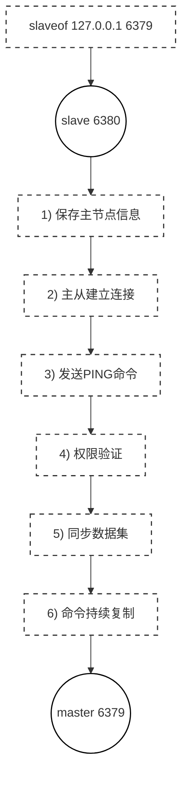

<!-- more -->
## 主从节点建立
当为从节点配置了主从复制后，流程如下：

1. 保存主节点信息：开始配置主从同步关系之后，从节点只保存主节点的地址信息，此时建立**复制流程还没有开始**，在从节点 6380 执行` INFO REPLICATION `可以看到如下信息：
```bash
127.0.0.1:6380> INFO REPLICATION
# Replication
......
master_host: 127.0.0.1
master_port: 6379
master_link_status: down # 主节点的连接状态是下线状态
......
```
2. 主从建立连接：从节点（slave）内部通过每秒运行的定时任务维护复制相关逻辑，当定时任务发现存在新的主节点后，会尝试与主节点建立基于 TCP 的网络连接。如果从节点无法建立连接，定时任务会**无限重试直到连接成功或者用户停止主从复制**。
3. 发送`PING`命令：连接建立成功之后，从节点通过`PING`命令确认主节点在应用层上是工作良好的。如果结果`PONG`回复超时，从节点会断开 TCP 连接，等待定时任务下次重新建立连接。
4. 权限验证：如果主节点设置了`requirepass`参数，则**需要密码验证**，从节点通过配置`masterauth`参数来设置密码。如果验证失败，则**从节点的复制将会停止**。
5. 同步数据集：对于首次建立复制的场景，主节点会**把当前持有的所有数据全部发送给从节点**，这步操作基本是耗时最长的，所以又划分称两种情况：***全量同步和部分同步***，下面会重点介绍。
6. 命令持续复制：当从节点复制了主节点的所有数据之后，针对之后的修改命令，主节点会持续的把命令发送给从节点，从节点执行修改命令，**保证主从数据的一致性**。

## 同步数据集
对于主从节点建立的第五步，这里来详细展开
Redis使用`PSYNC`命令完成主从数据同步，**同步分为全量复制和部分复制**
- 全量复制：一般用于初次复制场景，Redis 早期支持的复制功能只有全量复制，它会**把主节点全部数据一次性发送给从节点**，当数据量较大时，会对**主从节点和网络造成很大的开销**。
- 部分复制：用于处理在主从复制中**因网络闪断等原因造成的数据丢失场景**，当从节点再次连上主节点后，如果条件允许，**主节点会补发数据给从节点**。因为补发的数据远小于全量数据，可以有效**避免全量复制的过高开销**。

### PSYNC命令
`PSYNC`的语法格式如下
```bash
PSYNC <replicationid> <offset>
```
#### replicationid
`replicationid`表示**主节点的复制 ID**，用于**标识数据集的一段历史**。当 Redis 实例以主节点**重启**，或从节点**晋升**为主节点时，会**生成一个新的伪随机复制 ID**。
从节点在和主节点建立连接之后, 就会获取到主节点的 replicationid.
可以在主/从节点的`INFO REPLICATION`命令查看到
```bash
127.0.0.1:6379> INFO replication
# Replication
......
master_replid:7385f19df5d5a4f832e671fb49e162188f4dd308 # 主节点复制ID
master_replid2:0000000000000000000000000000000000000000
......
```
==master_replid2是干什么的？==
Redis 使用 master_replid **标识当前复制历史**，使用 master_replid2 **保留上一段复制历史的 ID**。

当从节点 B 被提升为主节点时，B 会生成新的 master_replid，并**将原来的复制 ID 保留为 master_replid2**，同时**记录旧复制历史的有效偏移量边界**。

这样，原来跟随旧主节点 A 的其他从节点重新连接 B 时，就有机会**使用旧复制 ID 发起`PSYNC`**，在满足条件时进行部分重同步。

注意：普通主从复制**不会因网络中断自动晋升从节点**；需要**哨兵**（Sentinel）、**人工操作**（`REPLICAOF NO ONE`）或其他故障转移机制。另外，master_replid2 并**不负责找回旧主节点**，也不能保证两边分歧的数据自动合并。

---
举个例子，现在主节点master_replid为`AAA`，slave2从节点的复制ID为`III`

当slave2执行`REPLICAOF NO ONE`后，slave2成为主节点，并把旧的主节点复制ID存到`master_replid2`中

但其他原先跟随主节点的机子，依旧跟随主节点，不会转为跟随slave2
还需要**手动指定slave1执行`REPLICAOF <slave2IP> <slave2Port>`**
这样当slave1跟随slave2后，slave1发送原先的AAA复制ID，slave2 也可以认出slave1现在的状态
若主节点挂了，就可以用这种方式故障转移

要想**自动化协调完整的故障转移过程**，就需要用到**哨兵（Sentinel）**

#### offset

参与复制的主从节点都会维护**自身复制偏移量**。它**以字节为单位**，**反映主节点复制流推进到了什么位置，主要用于主从复制时判断数据同步进度**。统计信息在`INFO REPLICATION`中的`master_repl_offset`参数中。

从节点（slave）**每秒钟上报自身的复制偏移量给主节点**，因此主节点也会**保存从节点的复制偏移量**
```bash
127.0.0.1:6379> INFO replication
# Replication
......
slave0:ip=127.0.0.1,port=6381,state=online,offset=210,lag=0 # offset是该从节点的字节偏移量
slave1:ip=127.0.0.1,port=6380,state=online,offset=210,lag=0
......
master_repl_offset:210 # 当前节点命令字节偏移量
......
```
当master执行命令后，**增加自己的复制偏移量**（master_repl_offset），把复制数据发送给从节点，当从节点接收后，再**推进自己的复制偏移量**（slave_repl_offset）

> **replid + offset 共同标识了一个 "数据集"**
> 如果两个节点, 他们的 replid 和 offset 都相同,则这两个节点上持有的数据, 就一定相同

#### PSYNC运行流程
1. 从节点发送`PSYNC <replid> <offset>`命令给主节点，当第一次向主节点发送时，不知道主节点的replid和offset，**默认值分别是`?`和`-1`**
2. 主节点根据`PSYNC`的参数和自身数据情况决定响应结果
	- 若`PSYNC`参数为默认值，**返回主节点的replid和offset**：`+FULLRESYNC <replid> <offset>`，从节点在接收后会进行**全量复制**
	- 若`PSYNC`参数不是默认值，则根据判断复制积压缓冲区的情况决定全量复制还是部分复制。如果返回`+CONTINEU`，从节点在接收后会进行**部分复制**
	- 若回复`-ERR`，说明 Redis 主节点版本过低，不支持 psync 命令。从节点可以使用`SYNC`命令进行全量复制。
3. 回复`-ERR`，说明 Redis 主节点版本过低，不支持`PSYNC`命令。从节点可以使用`SYNC`命令进行全量复制。


> - `PSYNC`一般**不需要手动执行**. Redis 会在主从复制模式下自动调用执行
> - `SYNC`会**阻塞** redis server 处理其他请求， `PSYNC`则不会.

## 全量复制
全量复制是 Redis 最早支持的复制方式，也是主从第一次建立复制时必须经历的阶段。流程如下：
1. 从节点首次复制时，发送`PSYNC ? -1`请求全量同步。
2. 主节点回复`+FULLRESYNC <replid> <offset>`，从节点保存主节点的复制 ID 和初始复制偏移量。
3. 主节点启动 RDB 快照生成过程，**同时缓存快照生成期间产生的写命令**。
4. 主节点将 RDB 数据发送给从节点；具体是通过**磁盘文件传输**还是**无盘方式传输**，取决于配置。
5. 从节点接收 RDB 数据，并在准备加载新数据集时**清除旧数据**，随后加载 RDB，建立基础数据集。
6. 主节点RDB 传输完成（注意不是从节点加载RDB完成）后，**主节点继续发送缓存的写命令，并持续发送后续写命令**。从节点按顺序应用这些命令，追上主节点的数据状态。（**从节点完成 RDB 加载后**，再处理后续复制命令，使自身数据追上主节点。）
7. 全量同步成功后，从节点进入正常复制状态。如果启用了 AOF，Redis 会重新启动 AOF 子系统并触发 AOF 重写。


==无磁盘复制（diskless）==
默认情况下, 进行全量复制需要主节点生成 RDB 文件**到主节点的磁盘中**, **再把磁盘上的 RDB文件通过发送给从节点**。
Redis 从2.8.18 版本开始支持**无磁盘复制**. 主节点在执行 RDB 生成流程时, 不会生成 RDB 文件到磁盘中了, 而是直接<u>把生成的 RDB 数据通过网络发送给从节点. 这样就节省了一系列的写硬盘和读硬盘的操作开销。</u>

---
通过分析全量复制的所有流程，我们会发现全量复制是一件**高成本的操作**：<u>主节点`BGSAVE`的时间，RDB 在网络传输的时间，从节点清空旧数据的时间，从节点加载 RDB 的时间等</u>。所以一般应该**尽可能避免**对已经有大量数据集的 Redis 进行全量复制。
	
## 部分复制
部分复制主要是 Redis 针对全量复制的过高开销做出的一种优化措施，使用`PSYNC <replicationId> <offset>`命令实现。

当从节点正在复制主节点时，如果出现网络闪断或者命令丢失等异常情况时，从节点会向主节点要求补发丢失的命令数据，如果主节点的**复制积压缓冲区**存在数据则直接发送给从节点，这样就可以保持主从节点复制的一致性。**补发的这部分数据一般远远小于全量数据，所以开销很小**。

==复制积压缓冲区==
复制积压缓冲区（Replication Backlog）是主节点用于保存最近复制数据的缓冲区，默认大小为 1MB。
当主节点连接**至少一个从节点时，会分配该缓冲区**。主节点传播写命令时，会将命令写入复制数据流，供从节点接收，同时保留复制历史，以便从节点断线重连时尝试执行部分重同步（PSYNC）。
最后一个从节点断开后，缓冲区默认保留 3600 秒，之后释放。

要修改复制积压缓冲区的大小，可以在配置文件中找`repl-backlog-size`参数
```bash
# Set the replication backlog size. The backlog is a buffer that accumulates
# replica data when replicas are disconnected for some time, so that when a
# replica wants to reconnect again, often a full resync is not needed, but a
# partial resync is enough, just passing the portion of data the replica
# missed while disconnected.
#
# The bigger the replication backlog, the longer the replica can endure the
# disconnect and later be able to perform a partial resynchronization.
#
# The backlog is only allocated if there is at least one replica connected.
#
# repl-backlog-size 1mb # 默认复制积压缓冲区大小
```
由于缓冲区逻辑上类似**先进先出的循环队列**，所以能实现保存最近已复制数据的功能，用于部分复制和复制命令丢失的数据补救。复制缓冲区相关统计信息可以通过主节点的`INFO REPLICATION`中：
```bash
127.0.0.1:6379> INFO replication
......
repl_backlog_active:1 # 开启复制缓冲区
repl_backlog_size:1048576 # 缓冲区最大长度
repl_backlog_first_byte_offset:1 # 起始偏移量，计算当前缓冲区可用范围
repl_backlog_histlen:81242 # 已保存数据的有效长度
......
```
通过这些参数，可以算出当前当前实际保存的字节范围：
$$
[
\begin{aligned}
\text{起始偏移量}&=\text{first\_byte\_offset}\\
\text{结束偏移量}&=\text{first\_byte\_offset}\\
&\quad+\text{histlen}-1
\end{aligned}
]
$$

---
### 部分复制流程：
1. **复制连接中断**：主从节点之间发生网络故障时，如果复制连接超过`repl-timeout`所设定的超时时间，主节点或从节点检测到超时后，可能关闭复制连接。
2. **主节点继续处理写操作**：连接中断期间，主节点仍可处理客户端请求，并继续产生复制数据流。复制积压缓冲区保留最近的复制数据，以便后续尝试部分重同步。
3. **从节点重新连接**：网络恢复后，从节点尝试重新连接主节点。
4. **发送 PSYNC 请求**：从节点将之前保存的复制 ID 和已处理的复制偏移量作为参数发送给主节点，请求部分重同步。
5. **主节点验证请求**：主节点验证复制 ID 和偏移量。<u>如果相应的复制历史仍然有效，并且积压缓冲区中保留了所需的后续数据</u>，则回复`+CONTINUE`；否则通常进行全量同步。
6. **补发缺失数据**：主节点从复制积压缓冲区中发送从节点缺失的复制数据。从节点接收并应用这些数据，之后继续正常复制，逐渐追上主节点。


==对于第五步，何时全量复制？==
由于复制积压缓冲区在逻辑上类似于先进先出的循环缓冲区，当新的复制数据不断产生时，**较早的复制数据会逐渐被淘汰**。

因此，如果**主从节点断连时间过长**，或者**断连期间产生的复制数据量过大**，从节点重新连接时，**所需的部分复制数据可能已经不在缓冲区中**。此时，主节点无法通过缓冲区补齐从节点缺失的数据，通常需要进行**全量复制**。

此外，如果从节点提供的**复制 ID 与主节点可识别的复制历史不匹配**，即使缓冲区中仍有数据，也可能需要进行全量复制。

## 实时复制

主从节点建立复制连接后，通过 **TCP 长连接**持续传输复制命令流，以同步数据集的变化。由于 Redis 默认采用**异步复制**，主从节点之间可能存在**短暂的数据延迟**。

为检测连接状态和确认复制进度，Redis 在复制协议中实现了**应用层心跳机制**：
1. 主节点默认每隔 10 秒向从节点发送`PING`，检测复制连接状态，可通过 `repl-ping-replica-period`修改周期。
```bash
# Master send PINGs to its replicas in a predefined interval. It's possible to
# change this interval with the repl_ping_replica_period option. The default
# value is 10 seconds.
#
# repl-ping-replica-period 10 # 默认PING周期
```
2. 从节点默认每隔约 1 秒向主节点发送`REPLCONF ACK <offset>`，**报告自身的复制偏移量**，供主节点**判断复制进度**、**检测超时**以及支**持相关复制协调**功能。
3. 默认情况下，`repl-timeout`为 60 秒。<u>主节点长时间未收到从节点的 ACK、从节点长时间未收到主节点的数据或`PING`、全量同步期间 从节点 等待 RDB 数据时发生超时</u>，都可能判定复制连接超时并关闭连接。
```bash
# The following option sets the replication timeout for:
#
# 1) Bulk transfer I/O during SYNC, from the point of view of replica.
# 2) Master timeout from the point of view of replicas (data, pings).
# 3) Replica timeout from the point of view of masters (REPLCONF ACK pings).
#
# It is important to make sure that this value is greater than the value
# specified for repl-ping-replica-period otherwise a timeout will be detected
# every time there is low traffic between the master and the replica. The default
# value is 60 seconds.
#
# repl-timeout 60 # 默认超时时间
```
4. 连接恢复后，从节点会重新连接主节点，并尝试通过`PSYNC`进行部分重同步；如果无法部分重同步，则执行全量同步。

>主节点`PING`主要用于**连接状态检测**，从节点`REPLCONF ACK <offset>`**既报告复制进度，也能辅助检测连接异常**。两者配合，维持正常的复制连接与状态跟踪。