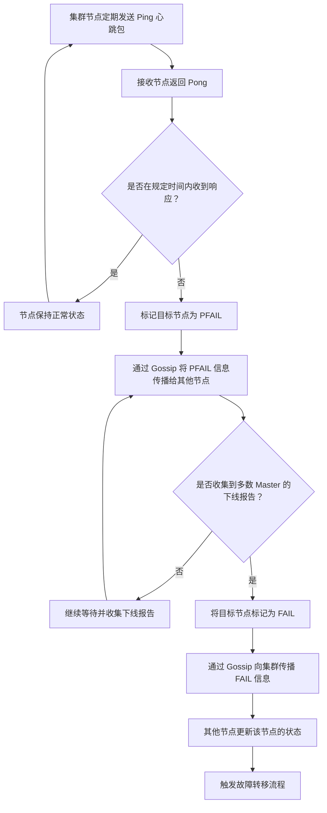
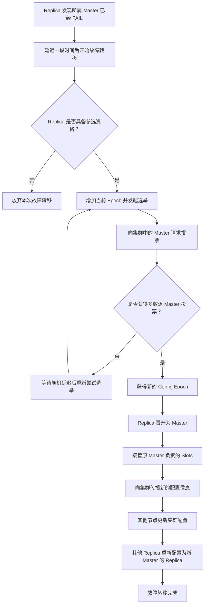

<!-- more -->
将一个三主六从的集群搭建完后，下面来介绍一下集群的常用操作

搭建步骤见下面这篇文章：
[Redis集群搭建](https://valexi-dev.github.io/blog/redis%E9%9B%86%E7%BE%A4%E6%90%AD%E5%BB%BA_20261112204314/)
# 故障转移
和哨兵一样，当集群的其中一个主节点宕机后，会**自动进行故障转移**，让从节点上位
先看一下现在的集群节点信息：
```bash
127.0.0.1:6371> CLUSTER NODES
a5b995a2443038b324490956bc8f89a0dbe80fe0 172.30.0.106:6379@16379 slave fe6484ec32c341f7d5e3a5f34148edb08ef4a387 0 1794273881000 1 connected
3cf24111ba1f19ee1d7b1b21c6e8c29fadeaa7e2 172.30.0.105:6379@16379 slave fe6484ec32c341f7d5e3a5f34148edb08ef4a387 0 1794273882000 1 connected
c04fe7a8a5c49aa9e6715b5c03fb6b380b049bf3 172.30.0.102:6379@16379 master - 0 1794273881682 2 connected 5461-10922
fe6484ec32c341f7d5e3a5f34148edb08ef4a387 172.30.0.101:6379@16379 myself,master - 0 1794273882000 1 connected 0-5460
7152e8a627588490d9ad366359609e393ab2e0df 172.30.0.104:6379@16379 slave 1ea90669f18311836762e94b6cf126f3abdcf670 0 1794273882586 3 connected
42a87e06efa00bf11c143e75fa2ef8a3ab510d9f 172.30.0.107:6379@16379 slave c04fe7a8a5c49aa9e6715b5c03fb6b380b049bf3 0 1794273882586 2 connected
52dff9a709b0d13c394a08a8631b58248e3f03b7 172.30.0.108:6379@16379 slave c04fe7a8a5c49aa9e6715b5c03fb6b380b049bf3 0 1794273881079 2 connected
1ea90669f18311836762e94b6cf126f3abdcf670 172.30.0.103:6379@16379 master - 0 1794273882000 3 connected 10923-16383
cb2d0d4fd9feb82f33107b0478634dbe40fcba85 172.30.0.109:6379@16379 slave 1ea90669f18311836762e94b6cf126f3abdcf670 0 1794273882000 3 connected
```
目前172.30.0.101, 102, 103是主节点
现在停掉101：`sudo docker stop redis1`，再进入其他任意一个节点：
```bash
127.0.0.1:6372> CLUSTER NODES
7152e8a627588490d9ad366359609e393ab2e0df 172.30.0.104:6379@16379 slave 1ea90669f18311836762e94b6cf126f3abdcf670 0 1794274151050 3 connected
42a87e06efa00bf11c143e75fa2ef8a3ab510d9f 172.30.0.107:6379@16379 slave c04fe7a8a5c49aa9e6715b5c03fb6b380b049bf3 0 1794274150548 2 connected
52dff9a709b0d13c394a08a8631b58248e3f03b7 172.30.0.108:6379@16379 slave c04fe7a8a5c49aa9e6715b5c03fb6b380b049bf3 0 1794274152000 2 connected
cb2d0d4fd9feb82f33107b0478634dbe40fcba85 172.30.0.109:6379@16379 slave 1ea90669f18311836762e94b6cf126f3abdcf670 0 1794274151000 3 connected
fe6484ec32c341f7d5e3a5f34148edb08ef4a387 172.30.0.101:6379@16379 master,fail - 1794274140505 1794274138000 1 connected
a5b995a2443038b324490956bc8f89a0dbe80fe0 172.30.0.106:6379@16379 master - 0 1794274152054 10 connected 0-5460
1ea90669f18311836762e94b6cf126f3abdcf670 172.30.0.103:6379@16379 master - 0 1794274152000 3 connected 10923-16383
3cf24111ba1f19ee1d7b1b21c6e8c29fadeaa7e2 172.30.0.105:6379@16379 slave a5b995a2443038b324490956bc8f89a0dbe80fe0 0 1794274152053 10 connected
c04fe7a8a5c49aa9e6715b5c03fb6b380b049bf3 172.30.0.102:6379@16379 myself,master - 0 1794274151000 2 connected 5461-10922
```
101节点显示 `master,fail` ，原先是 slave 的 106 上位成 master
之后即使 101 重新启动，也会变成 slave

若想让 101 重新变为 master，可登录101节点客户端，执行`CLUSTER FAILOVER`，该命令会**手动触发从节点进行故障转移**，**将当前主节点的身份转移给该从节点**
## 故障转移流程
### 故障判定
集群中的所有节点（Master 和 Slave）都会周期性地通过 Cluster Bus 交换心跳信息。
1. **PING / PONG 心跳通信**
节点 A 向节点 B 发送 PING 包，B 收到后会向 A 返回 PONG 包。

	PING 和 PONG 除了 Message Type 等必要字段不同之外，都会携带相应的集群信息，例如：
	- 节点 ID。
   - 当前 Epoch 和 Config Epoch。
   - 节点角色（Master / Replica）。
   - 从节点所属的 Master ID。
   - 当前节点负责的 Slots 位图（Replica 携带其 Master 的槽位信息）。
   - 节点之间的通信端口、集群状态等。
此外，PING 和 PONG 还**包含 Gossip 信息**，用于传播发送节点所观察到的其他节点的状态。
2. **随机选择节点发送 PING**
	每个节点都会**周期性地向集群中的部分节点**发送 PING 包，而不是每次都向所有节点发送。

	这样可以避免节点数量较多时产生大量心跳通信。
   
   例如，集群有 9 个节点，如果每个节点都与其他 8 个节点频繁发送心跳，那么通信关系会达到：
   $$
   N(N-1)=9\times8=72
   $$
   这种全量通信的规模会随着节点数量**呈平方级增长**。
   
   Redis Cluster 通过**随机选择部分节点进行 Gossip 通信**，降低了心跳通信开销。同时，会**优先关注长时间没有收到 PONG 响应的节点**。
   
   
3. **判定 PFAIL（主观下线）**
   
   当节点 A 向节点 B 发送 PING 包后，如果 B 在`cluster-node-timeout`指定的时间内没有响应，A 会尝试重新建立 TCP 连接。
   
   如果仍然无法正常通信，A 就会将 B 标记为 **PFAIL**（Possible Failure）。
   
   注意：
   - Master 和 Slave 都可以将其他节点标记为 PFAIL。
   - **PFAIL 只是当前节点自己的故障判断**，不代表整个集群已经确认 B 故障。
4. 通过 Gossip 传播故障信息
   
   A 将 B 标记为 PFAIL 后，会通过 Gossip 协议向其他节点传播自己观察到的节点状态。
   
   其他节点也会将自己观察到的故障信息传播出去。
   
   每个节点都会**维护自己的集群状态信息**，因此不同节点对同一个目标节点的判断可能暂时不一致。
   
   例如：
   - A 认为 B 是 PFAIL。
   - C 认为 B 是 PFAIL。
   - D 认为 B 仍然正常。
5. **判定 FAIL（客观下线）**
   
   当节点 A 收集到足够多的有效故障报告后，就可以将 B 从 PFAIL 升级为 FAIL。
   
   具体条件是：
   - **A 已经将 B 标记为 PFAIL。**
   - A 通过 Gossip 收集到了其他 Master 对 B 的故障报告。
   - 在规定的有效时间范围内，**报告 B 为 PFAIL 或 FAIL 的 Master 数量达到了整个集群 Master 总数的多数**。
   注意：
   		- **只有 Master 的故障报告可以参与多数派判定**。
   		- Replica 可以检测故障、标记 PFAIL 和传播故障信息，但**不能提供有效的 Master 故障报告**。
   		- 故障报告必须在有效时间范围内，不能无限期累计。
   在当前 Redis 实现中，故障报告的有效时间通常为：
   $$
   2\times cluster\text{-}node\text{-}timeout
   $$
   当条件满足后，A 就会将 B 标记为 FAIL，并向其他可达节点发送 FAIL 消息。其他节点收到后也会将 B 标记为 FAIL。
   
   	至此，B 被集群判定为故障节点。

	==集群什么时候会整体进入 FAIL 状态？==
某个或者某些节点宕机，有时会导致整个 Redis Cluster 无法正常提供服务。
主要有以下三种情况：
	- 某个分片的 Master 和所有 Replica 都挂了，导致该分片负责的 Slots 无法访问。
	- 某个分片的 Master 挂了，而且没有可用的 Replica 可以接管。
	- 超过半数的 Master 不可达，集群失去多数派，无法正常维持集群服务。

补充：

Redis Cluster 默认配置：
`cluster-require-full-coverage yes`
在该配置下，**只要有哈希槽无法正常覆盖，集群整体就会进入 FAIL 状**态，停止正常的数据访问。

如果将其设置为 no，则允许集群继续服务于仍然可用的哈希槽。


### 故障转移
在上述例子中，假设 B 故障，并且 A 将 B 标记为 FAIL，同时把故障信息传播给集群中的其他节点。
- 如果 B 是 Replica，那么通常不需要进行故障转移。
- 如果 B 是 Master，那么 **B 的 Replica（例如 C 和 D）就会尝试发起故障转移**。

所谓故障转移，就是将原 Master 的某个 Replica 晋升为新的 Master，接管原 Master 负责的哈希槽，继续为 Redis Cluster 提供服务。

具体流程如下：
1. **判断 Replica 是否具有参选资格**

	当 Replica 发现自己的 Master 已经处于 FAIL 状态时，就会判断自己是否具有参选资格。
	如果 Replica 与 Master 断开连接的时间太久，就会认为自己的**数据可能已经落后太多**，从而失去参选资格。
	
	Redis 通过以下配置控制：
    ```bash
    cluster-node-timeout 15000 # 集群节点超时时间
    cluster-replica-validity-factor 10 # 从节点有效性系数
    ```

	在默认配置下，Redis 会根据`cluster-node-timeout`和`cluster-replica-validity-factor`判断 Replica 的数据是否足够新。
	例如：
$$
15000\times10=150000ms
$$
	也就是 150 秒。

	如果 Replica 与 Master 断开连接的时间超过相应的有效性阈值，就不能参与故障转移。

	注意：150 秒是上述默认参数下的主要判断阈值，不是所有情况下固定不变的参选时间。

2.  **根据复制偏移量确定 Rank，并进行随机休眠**

	具有参选资格的 Replica（例如 C 和 D）不会立即发起选举，而是**先休眠一段时间**。

	休眠时间计算公式：
$$
DELAY=500ms+Random(0,500ms)+Rank\times1000ms
$$
	其中：
	- 500ms：**基础等待时间**，让 FAIL 状态有时间传播到集群中的其他 Master。
	- Random(0,500ms)：**随机延迟**，避免多个 Replica 同时发起选举。
	- Rank：Replica **根据复制偏移量确定的排名**。

	Rank 的确定依据是复制偏移量（Replication Offset）：
	- 复制偏移量越大，通常说明 Replica 已经同步了更多数据。
	- 复制偏移量越大，Rank 越靠前（数值越小）。
	- Rank 越小，等待时间越短。

	例如：
	
    | Replica | 复制偏移量 | Rank |
    |--|--|--|
    | C | 10000 | 0 |
    | D | 9500 | 1 |
    |E | 9000 | 2 |

	那么它们的基础等待时间分别为：
    | Replica | 基础等待时间 |
    |--|--|
    | C | 500ms |
    | D | 1500ms |
    | E | 2500ms |

	这里还需要加上各自的随机延迟。

	因此，C 通常最先发起选举。

3. **Replica 发起选举并向 Master 请求投票**
 
	当 C 的休眠时间结束后，就会向集群中的所有 Master **发送投票请求**。

	在正式发起选举时，**C 会先递增自己的 currentEpoch**（集群配置纪元，相当于集群配置版本号），然后发送 	*FAILOVER_AUTH_REQUEST* 消息请求投票。

	注意：
	- **只有 Master 有投票资格。**
	- Replica 不参与投票。
	- 每个 Master 在同一个 Epoch 中只能投出一票。
	- **Master 只会在满足相应条件时授予投票**，例如确认原 Master 已经处于 FAIL 状态。

4. **获得多数派投票，晋升为新的 Master**

	假设集群有 3 个 Master：
	
    | Master |	投票结果 |
    |--|--|
    | A | 投给 C |
    | B | 投给 C |
    | 原 Master | 已经故障，无法投票 |

	C 获得了 2 票，超过 Master 总数的一半，因此选举成功。

	也就是说：
$$
Votes>\frac{MasterCount}{2}
$$

	选举成功后：
	1. **C 获得一个新的、唯一且递增的 Config Epoch。**
	2. C 将自己的角色从 Replica 转换为 Master。
	3. C 接管原 Master 负责的 Slots。
	4. C 开始向集群中的其他节点传播新的配置信息。

	其他 Replica（例如 D）会根据集群的新配置，重新配置为 C 的 Replica。

	注意：这里不只是简单执行`SLAVEOF NO ONE`和`SLAVEOF C`，还涉及 **Epoch 更新、槽位归属变更以及集群配置传播**。

5. **同步新的集群配置信息**

	C 成为新的 Master 后，会通过 PING、PONG 等 Cluster Bus 消息向其他节点传播自己的新身份和槽位信息。

	其他节点收到后，会比较新旧配置的 Config Epoch：
$$
NewConfigEpoch>OldConfigEpoch
$$

	如果发现新的配置纪元更大，就会更新自己保存的槽位归属信息。（不会更新 Config Epoch）

	这样，集群中的其他节点就会逐渐**统一对新 Master 和槽位归属的认知**。

	原 Master 如果之后恢复，也会根据集群中的新配置重新调整角色，成为新 Master 的 Replica。



---

选举机制说明：

Redis Cluster 的故障转移选举机制**借鉴了 Raft 算法的部分思想**，使用 Epoch 和多数派投票机制来协调节点之间的选举。

但 Redis Cluster 并没有完整实现 Raft 算法，不能直接将其称为完整的 Raft 算法。

另外，在随机休眠时间的加持下，Rank 靠前的 Replica 通常会先发起选举，但并不意味着谁先唤醒谁就一定成功。

最终仍然需要获得多数 Master 的投票授权。

###  两个容易混淆的概念
1. Current Epoch 和 Config Epoch

	| 概念            | 含义                | 主要作用                 |
	| ------------- | ----------------- | -------------------- |
	| Current Epoch | 当前节点已知的**集群最大逻辑纪元**   | 用于协调故障转移过程中的选举和投票    |
	| Config Epoch  | Master 所负责的**槽位配置版本** | 用于判断槽位归属配置的新旧，解决配置冲突 |

	可以简单理解为：
	- **Current Epoch：** 主要用于**协调选举**。它类似于**集群的逻辑时钟**，在选举过程中会递增。节点也会通过集群通信**获知更大的 Epoch，并更新自己的 Current Epoch**，使各节点逐渐**对集群当前的选举轮次达成一致**。
	- **Config Epoch：** 主要用于确定哪个 Master 的**槽位配置更新**。可以理解为各个 Master 独立维护的配置版本号。故障转移成功后，新 Master 会获得新的 Config Epoch，其他节点会更新对应的节点信息和槽位归属，但不会将自己的 Config Epoch 统一更新为最新值。


2. PFAIL 和 FAIL

	| 概念 | 含义	| 判定权限 |
	|--|--|--|
	| PFAIL | **主观下线**，某个节点认为目标节点不可达 | Master 和 Replica |
	| FAIL | **客观下线**，集群通过多数 Master 的有效故障报告确认节点故障 | 需要多数 Master 报告 |

# 集群扩容
此处用一开始compose.yml配置的redis10作为主节点，redis11作为从节点，进行集群扩容
## 新增主节点
```bash
redis-cli --cluster add-node 172.30.0.110:6379 1 172.30.0.101:6379
```
意为将`172.30.0.110:6379`添加到`172.30.0.101:6379`所属的集群中（后面的节点只要是集群中的任意一个节点即可）

但现在的新主节点没有负责任何槽位
```bash
127.0.0.1:6371> CLUSTER NODES
7fa4db3024206501a642c4d45489136621818b66 172.30.0.110:6379@16379 master - 0 1794362473000 0 connected
a5b995a2443038b324490956bc8f89a0dbe80fe0 172.30.0.103:6379@16379 master - 0 1794362472000 3 connected 10923-16383
......
```
需要通过`--cluster reshard`命令给集群**重新切分槽位**
```bash
redis-cli --cluster reshard 172.30.0.101:6379
```
该命令的`ip:port`可以是集群中任意一个节点
运行后该命令会问三个问题：
```bash
How many slots do you want to move (from 1 to 16384)?
What is the receiving node ID?
Please enter all the source node IDs.
  Type 'all' to use all the nodes as source nodes for the hash slots.
  Type 'done' once you entered all the source nodes IDs.
Source node #1: 
```
翻译过来为：

> 您想移动多少个插槽（从1到16384）？
接收节点的ID是什么？
请输入所有源节点的ID。
 输入“all”以将所有节点作为哈希槽的源节点。
 输入完所有源节点ID后，请输入“done”。
源节点#1：

对于当前集群，我想通过原先主节点的槽位分给110节点4096个槽位（16384/4=4096），因此三个问题依次填：
```bash
4096
7fa4db3024206501a642c4d45489136621818b66 # 这里填110节点的ID
all
```
reshard完成后，再看一下各节点负责的槽位：
```bash
127.0.0.1:6371> CLUSTER NODES
7fa4db3024206501a642c4d45489136621818b66 172.30.0.110:6379@16379 master - 0 1794365488040 12 connected 0-1364 5461-6826 10923-12287
......
1ea90669f18311836762e94b6cf126f3abdcf670 172.30.0.103:6379@16379 master - 0 1794365487037 3 connected 12288-16383
c04fe7a8a5c49aa9e6715b5c03fb6b380b049bf3 172.30.0.102:6379@16379 master - 0 1794365486000 2 connected 6827-10922
fe6484ec32c341f7d5e3a5f34148edb08ef4a387 172.30.0.101:6379@16379 myself,master - 0 1794365486000 11 connected 1365-5460
42a87e06efa00bf11c143e75fa2ef8a3ab510d9f
......
```
110节点负责的槽位为[0,1364] [5461,6826] [10923,12287]，是原先三个主节点各自分给的一点

## 新增从节点
若想给集群中的主节点新增从节点：
```bash
redis-cli --cluster add-node \
172.30.0.111:6379 \
172.30.0.101:6379 \
--cluster-slave
[--cluster-master-id 主节点id]
```
`172.30.0.111:6379`代表新加入集群的节点
`172.30.0.101:6379`代表集群入口节点，用于获取集群信息

若指定`--cluster-master-id`，则成为指定 Master 的 Slave，否则由 Redis 自动选择 Master

# 集群缩容
一般来说其实不会有缩容的情况，但这里为了全面，就介绍一下
这里拿上面刚扩容的110和111节点做缩容示例
## 删除从节点
要想删除一个 Master，需要**先删掉该 Master 的 Slave**，即111节点
```bash
redis-cli --cluster check 172.30.0.101:6379 # 若不知道该节点的ID，可以用该命令查看所在节点的集群的所有ID
redis-cli --cluster del-node 172.30.0.101:6379 a581422744f2ddd9ec1824aab3a858ad0eb0a51f # 要删除节点的ID
```
`--cluster del-node`命令后跟着的`ip:port`只是**集群的入口节点**，并不是要删除的节点，**后面的nodeID才是**
**被该命令删除的节点必须没有分配哈希槽**，因此通常用于删除从节点
## 重新分配slots
现在110节点管理着哈希槽，需要`--cluster reshard`**先将这些哈希槽移交给其他节点**，这里将110节点的哈希槽都移交给101节点（也可以分三次reshard，各个连续的哈希槽段还给对应 Master）
```bash
redis-cli --cluster reshard 172.30.0.101:6379 # 再强调一遍，这里的ip:port是集群入口，不是指定节点
```
这次三个问题的答案就变成了：
```bash
1. 4096
2. fe6484ec32c341f7d5e3a5f34148edb08ef4a387 # 101节点ID
3. 7fa4db3024206501a642c4d45489136621818b66 # 110节点ID
   done
```
在执行完后，会发现110节点自动变成了101节点的 Slave
```bash
127.0.0.1:6371> CLUSTER NODES
7fa4db3024206501a642c4d45489136621818b66 172.30.0.110:6379@16379 slave fe6484ec32c341f7d5e3a5f34148edb08ef4a387 0 1794404735000 13 connected
fe6484ec32c341f7d5e3a5f34148edb08ef4a387 172.30.0.101:6379@16379 myself,master - 0 1794404735000 13 connected 0-6826 10923-12287
......
```
这是因为<u>当一个 Master 失去了自己最后一个哈希槽时，会自动重新配置为**偷走它最后一个哈希槽**的 Master 的 Slave</u>

此时再删除110从节点即可
```bash
redis-cli --cluster del-node 172.30.0.101:6379 7fa4db3024206501a642c4d45489136621818b66
```
# 集群常用命令
## Hash Tag
在 Redis Cluster 中，使用`MSET`、`MGET`等等这种命令，若涉及到的Key们所处于的**哈希槽不归一个 Master 管**，就会出现下面这种错误：
```bash
127.0.0.1:6371> mset k1 v1 k2 v2 k3 v3
CROSSSLOT Keys in request don't hash to the same slot
```
意为：k1、k2、k3 计算出来的哈希槽不同，而 Redis Cluster 不允许一个普通的多 Key 命令**跨越多个槽位执行**

Redis Cluster 支持 Hash Tag 机制：**如果 Key 中包含 {...}**，那么**只对大括号内的内容进行哈希计算**，例如：
```bash
MSET k1{zelda} v1 k2{zelda} v2 k3{zelda} v3
```
k1 k2 k3 都包含{zelda}，因此它们会被分配到同一个哈希槽

若想查看指定key在哪个槽位，可以用`CLUSTER KEYSLOT <key>`命令
```bash
127.0.0.1:6371> CLUSTER KEYSLOT k1{zelda}
11228
127.0.0.1:6371> CLUSTER KEYSLOT k2{zelda}
11228
127.0.0.1:6371> CLUSTER KEYSLOT k3{zelda}
11228
```
若想查看某个哈希槽位有几个Key，可以用`CLUSTER COUNTKEYSINSLOT <槽号>`
例如当前11228槽位就存了`k1{zelda}` `k2{zelda}` `k3{zelda}` 三个Key
```bash
127.0.0.1:6371> CLUSTER COUNTKEYSINSLOT 11228
(integer) 3
```